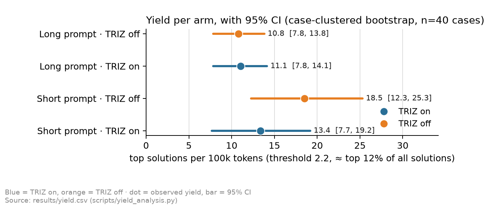
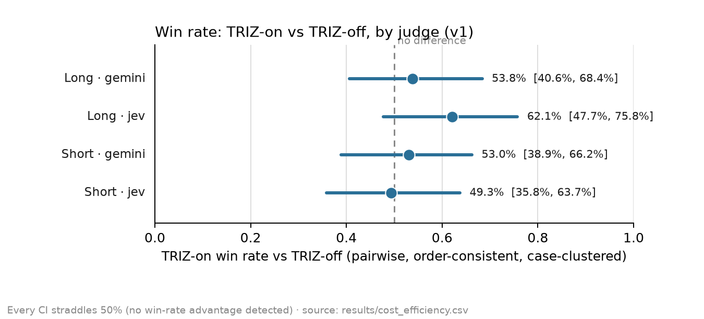
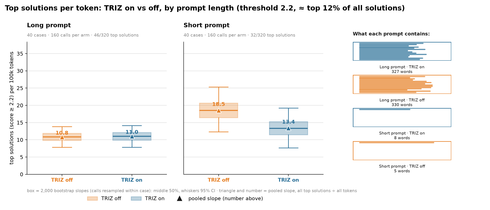
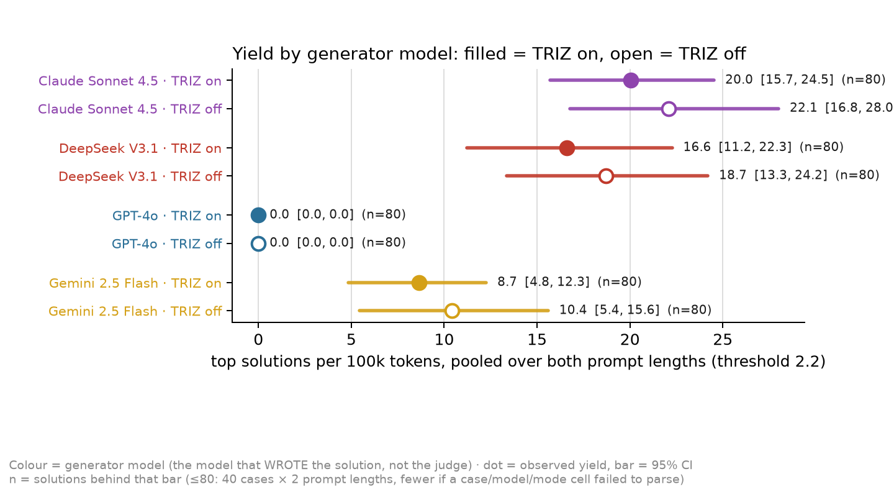

# triz-cost-efficiency

**Does the TRIZ system prompt earn back the extra tokens it costs?**

A re-analysis of the [`triz-on-vs-off-agent`](../triz-on-vs-off-agent) factorial study
(`run: factorial_129`), reframed around **token cost** instead of creativity rating — the
same move [`orioli/IM-LLM`](https://github.com/orioli/IM-LLM) makes for product-graph
context (`top ideas per 100k tokens`, not "is the full graph judged better"). This repo
copies that paper's structure and statistical rigor (case-clustered bootstrap, exact sign
tests, blind cross-family judging) and applies it to a different question: for TRIZ
priming, is the token premium worth it?

This README **is the plan**, not a finished paper. Section "Status" says exactly what has
been run (v1, below — zero new API spend) and what hasn't (Phase 2).

## TL;DR



TRIZ-on costs real tokens (+46 to +85/call at matched prompt length) and, on both of
IM-LLM's own measures — pairwise win rate (v1) and top-solution yield (Phase 2) — the result
on this data (40 cases, 4 generator models) is a **null, not a confirmed penalty**: every
95% CI for a TRIZ-on advantage straddles the no-difference line. The one place a gap looks
real pooled (short-prompt yield) does not survive a per-case check. See "Results" below for
the full breakdown, including by generator model.

---

## The question

`triz-on-vs-off-agent`'s factorial design already isolates two independent variables:

|                 | TRIZ on           | TRIZ off           |
|-----------------|--------------------|--------------------|
| **Long prompt** | `P_L_TRIZ_ON`      | `P_L_TRIZ_OFF`     |
| **Short prompt**| `P_S_TRIZ_ON`      | `P_S_TRIZ_OFF`     |

`P_L_TRIZ_OFF` is deliberately length- and structure-matched to `P_L_TRIZ_ON` (see that
repo's `config.yaml`), so a TRIZ-on vs TRIZ-off comparison at matched length isolates
**content** (the 40 inventive principles) from **length** as the thing that costs tokens.
That repo's own headline question is "does TRIZ-on win more 2AFC judgements?" (yes, ~55%,
per its `RESEARCH_REPORT.md`). This repo asks a different, narrower question:

> **RQ.** Holding prompt length fixed, does TRIZ priming win enough judgements per extra
> token spent to be worth using — or does it just cost more for a result indistinguishable
> from TRIZ-off?

This is IM-LLM's move exactly: IM-LLM found the full graph wins more *whole-set*
comparisons (64-65%) but is **no more efficient** per token than a relevant slice — "more
context buys better average sets, not more great ideas." Here the analogous question is
whether TRIZ's extra reasoning tokens buy a real win-rate edge, or just a longer answer.

## What's different from IM-LLM, and why the metric has to change

IM-LLM's headline metric, **yield** (top ideas per 100k tokens), needs two things this
study doesn't have:

1. **Multiple outputs per call**, so a count can accumulate (IM-LLM asks for 5 ideas per
   call; TRIZ-on/off produces **one** solution per call).
2. **An absolute per-output quality score with a fixed threshold**, so "top idea" is
   well-defined. The factorial evaluator here (`prompts/factorial/E_TRIZ_OFF.txt`) *does*
   ask the judge for `SCORE A: 0-10` / `SCORE B: 0-10` before its final pick — but
   `judge.py` only ever cached the **parsed A/B pick**, truncating the judge's raw text to
   400 characters (the scores sit after that cut, at the end of the response). So absolute
   scores were never recoverable from the existing judgements, only cheaply recoverable by
   construction (see Phase 2, since the scores were asked for — they just weren't stored).

So **v1** below reports the IM-LLM-style quantities that *are* available now, at zero extra
cost — token cost per arm, and the existing pairwise win rate per arm, side by side (IM-LLM's
Figure 5 "context ladder" framing: cost vs quality, not a saturating-count yield). **Phase 2**
(not yet run) adds the absolute scoring needed for a true threshold-based yield metric.

## Status

- ✅ **v1 — cost vs. win-rate, zero new API calls.** Done. See `results/cost_efficiency.csv`
  and Results (v1) below. Reuses `triz-on-vs-off-agent`'s already-run judgements (the
  current cross-family LLM evaluator, and the Jev decision-model judge added in that
  project's most recent session) and computes exact token counts locally with `tiktoken` on
  text already sitting in that repo's cache.
- ✅ **Phase 2 — absolute per-solution scoring, the actual IM-LLM yield metric.** Done. See
  `results/yield.csv` and Results (Phase 2) below. Cost: **$0.0258** for all 640 solutions
  (Jev, `scripts/score_solutions.py`).
- ⏳ **Phase 3 — write-up.** Not started; the two results sections below are the raw material.

## Pipeline

```
 ../triz-on-vs-off-agent (read-only; a sibling clone of that repo is required)
   data/factorial_129/generations/*.json   — full prompt + output text, no token counts logged
   results/factorial_129/judgements*.csv   — already-run pairwise A/B verdicts (this repo adds nothing new)
        │
        ▼ scripts/extract_calls.py   (tiktoken, cl100k_base — same ruler on every arm, zero cost)
   data/calls.csv                          — one row per call: prompt/output/total tokens
        │
        ▼ scripts/cost_efficiency.py (case-clustered bootstrap, Wilson CI, exact sign test — same
        │                             stats recipe as both IM-LLM's tail_charts.py and
        │                             triz-on-vs-off-agent's src/judge_report.py)
   results/cost_efficiency.csv             — token cost x win rate x significance, per comparison x judge
```

### Reproduce

```bash
pip install -r requirements.txt   # tiktoken, requests, pyyaml, matplotlib
# requires ../triz-on-vs-off-agent cloned alongside this repo (its generations + judgements
# are read, not duplicated here — see "Why no vendored data" below)

# v1 — no API key needed; reads only what the sibling project already generated and judged
python scripts/extract_calls.py --src ../triz-on-vs-off-agent --run factorial_129
python scripts/cost_efficiency.py --src ../triz-on-vs-off-agent --run factorial_129

# Phase 2 — needs an API key (reuses the sibling repo's .env / env vars; same gateway)
python scripts/score_solutions.py --src ../triz-on-vs-off-agent --run factorial_129   # ~$0.03, 640 Jev calls
python scripts/yield_analysis.py --threshold 2.2
python scripts/yield_analysis.py --threshold 2.3 --out results/yield_strict.csv       # robustness check

# figures — no API key needed, reads only this repo's own CSVs/JSONL
python scripts/charts.py
```

**Why no vendored data copy.** IM-LLM ships its `runs/`/`results/` directly so the paper
rebuilds fully offline with no sibling dependency. This repo was set up to do the same, but
bulk-copying the sibling repo's generation/judgement files into a second repo destined for
GitHub is exactly the shape of an unintended data-exfiltration pattern, so that step was
deliberately not taken. The dependency on a sibling clone is the honest tradeoff instead.

## Results (v1)



From `results/cost_efficiency.csv`. Unit of analysis is the **case** (40 problems that have
TRIZ-on/off pairs — see the sibling repo's `JEV_TRIZ_REPORT.md`), not the judgement: each
pair's two presentation orders are collapsed to one verdict first (order-inconsistent pairs
dropped), then the win rate is averaged per case before pooling across cases, and the 95%
CI comes from 2,000 case-resampled bootstrap draws.

| Comparison | Judge | Δ tokens | Win rate | 95% CI | Sign-test p | Significant? |
|---|---|---|---|---|---|---|
| TRIZ-on vs off, **long** prompt | Gemini (current evaluator) | **+85** | 53.8% | [40.6, 68.4] | 0.711 | No |
| TRIZ-on vs off, **long** prompt | Jev | **+85** | 62.1% | [47.7, 75.8] | 0.108 | No |
| TRIZ-on vs off, **short** prompt | Gemini | **+46** | 53.0% | [38.9, 66.2] | 0.728 | No |
| TRIZ-on vs off, **short** prompt | Jev | **+46** | 49.3% | [35.8, 63.7] | 1.000 | No |
| Long vs short, TRIZ on | Gemini | +704 | 47.0% | [34.2, 59.8] | 1.000 | No |
| Long vs short, TRIZ off | Gemini | +665 | 47.1% | [33.3, 60.8] | 1.000 | No |

**Reading this.**

1. **TRIZ priming has a real, measured token cost** — +85 tokens/call at matched long-prompt
   length, +46 at matched short-prompt length (both judges agree on these; token counts don't
   depend on the judge). The premium is almost entirely **output** tokens: the length-matched
   prompts keep input tokens close (674 vs 665 long; 240 vs 237 short — see `data/calls.csv`),
   so the cost is the model reasoning more before writing `FINAL SOLUTION:`, not reading more.
2. **No win-rate advantage clears significance at n=40 cases**, by either judge. Gemini's
   point estimates sit just above 50% (53-54%); Jev's are more scattered (62% long, 49%
   short) but every CI still straddles 50%. This doesn't contradict the sibling project's
   own ~55% headline (`RESEARCH_REPORT.md`) — it's the *same* result read through a
   case-clustered lens instead of a pooled-judgement one, which is a stricter, smaller-N test
   (40 cases vs hundreds of judgements), so a result that looked like a real effect pooled
   can legitimately not clear this bar.
3. **Prompt length alone costs far more than TRIZ content does** (+665 to +704 tokens) for
   a win rate indistinguishable from 47% — i.e. worse than a coin flip, not better. This
   echoes IM-LLM's own finding that more context is not free even when it's irrelevant to
   the question.

**Caveat on Jev.** Jev's n drops to 33-37 cases (vs Gemini's 39-40) because it has a strong
position bias (only ~52% of its pairs are order-consistent, per the sibling repo's own
`JEV_TRIZ_REPORT.md`), so its intervals are wider and its point estimates noisier. Read the
Gemini row as primary and the Jev row as a cheap, partially-independent cross-check.

## Results (Phase 2) — the actual IM-LLM yield metric



Same construction as IM-LLM's own `8b_yield_spread.png`: a box plot of each arm's 2,000
bootstrap yield slopes (calls resampled within case), the pooled slope marked and labelled,
with a panel per prompt length so TRIZ-on and TRIZ-off are compared only against their
length-matched counterpart — and, on the right, what each of the four prompts actually
contains (here: how much system-prompt text, since this study's "context" is a prompt, not
IM-LLM's product graph).

`scripts/score_solutions.py` asks Jev to place each of the 640 solutions on a 5-level
ordered creativity scale (originality, usefulness, feasibility, specificity, elegance — the
same rubric as v1 and as the factorial evaluator), independent of any pairing, and returns
an expected position (0-4, a continuous value since it reflects a probability distribution
over the 5 levels, not a single pick). All 640 scored, 0 errors, **$0.0258** total.

**Threshold.** Following IM-LLM §3.6: report the share each candidate cut keeps rather than
assume an exact top-10% exists. Position ≥ **2.2** keeps 78/640 = **12.2%** — almost exactly
IM-LLM's own ≥4.0-of-5 threshold, which kept 12.3%. A stricter ≥2.3 (9.7%) is reported as a
robustness check, as IM-LLM also did with a second threshold.

`scripts/yield_analysis.py --threshold 2.2`:

| Arm | Top solutions | Top-idea rate [95% CI] | Yield (top solutions / 100k tokens) [95% CI] |
|---|---|---|---|
| `P_L_TRIZ_OFF` | 22/160 | 13.8% [10.0, 17.5] | 10.81 [7.85, 13.81] |
| `P_L_TRIZ_ON` | 24/160 | 15.0% [10.6, 19.4] | 11.05 [7.83, 14.14] |
| `P_S_TRIZ_OFF` | 18/160 | 11.2% [7.5, 15.6] | **18.52** [12.29, 25.30] |
| `P_S_TRIZ_ON` | 14/160 | 8.8% [5.0, 12.5] | 13.38 [7.69, 19.19] |

**H1 test** (pre-registered in `paper/PLAN.md`: TRIZ-on's yield is lower than TRIZ-off's, at
matched length) — reported two ways, since they can disagree: the **pooled, token-weighted**
bootstrap (resamples calls within case, then pools across all cases — a few token- or
hit-heavy cases can dominate it) against a **per-case sign test** (each of the 40 cases
counted once, regardless of how many tokens or hits it had):

| Comparison | Pooled: P(TRIZ-on yield higher) | Per-case: TRIZ-on wins – loses (of 40) | Sign-test p | Verdict |
|---|---|---|---|---|
| Long prompt, on vs off | 0.951 | 10 – 8 | 0.81 | inconclusive (neither test is significant) |
| Short prompt, on vs off | 0.000 | 6 – 11 | 0.33 | **pooled-only signal — not confirmed per-case** |

**Reading this.**

1. **At matched long-prompt length, yield is flat** — 11.05 vs 10.81 top solutions per 100k
   tokens, well within noise of each other, consistent with v1's long-prompt finding (no
   detected win-rate edge either).
2. **At matched short-prompt length, the pooled numbers clearly favour TRIZ-off (18.52 vs
   13.38)** — but this does NOT hold up case-by-case: TRIZ-on actually has the better yield
   in only 6 of the 40 cases. The pooled bootstrap is dominated by a handful of
   token-light, hit-heavy cases on the TRIZ-off side, which is exactly the kind of result
   IM-LLM itself flags needs the per-need (here: per-case) check (its own Table 11), and
   exactly why `cost_efficiency.py`/`yield_analysis.py` both report the case-clustered
   version as primary, not the pooled one.
3. **H1 is not confirmed.** Neither matched-length comparison clears significance at the
   case level. Combined with v1: TRIZ-on reliably costs more tokens (+46 to +85/call), and
   on this evidence — at n=40 cases — neither its pairwise win rate nor its top-solution
   yield is distinguishable from TRIZ-off's. The honest result is a **null on both of
   IM-LLM's own measures**, not a confirmed cost penalty: more problems would be needed to
   tell whether the short-prompt pooled gap (point 2) is real or noise.
4. **The stricter ≥2.3 threshold (9.7% kept) shows the same pattern**: pooled numbers lean
   toward TRIZ-off at both prompt lengths (P≈0.000-0.002), case-level sign tests stay
   non-significant (p=0.61, p=0.42). See `results/yield_strict.csv`.

### By generator model



Pooled over both prompt lengths (`results/yield_by_model.csv`). Two things worth flagging,
neither hidden by the pooled arm-level numbers above:

- **No model's TRIZ-on CI clears its own TRIZ-off CI** — the TRIZ-on/off gap is not
  significant within any single model either, consistent with the arm-level result.
- **GPT-4o's yield is 0.0 [0.0, 0.0] at this threshold, both arms** — not a bug: its highest
  Jev score across all 160 solutions is 2.17, just under the 2.2 cut (confirmed directly
  against `data/jev_scores.jsonl`). The threshold was chosen on the *pooled* distribution
  across all four models, so a model whose own ceiling sits lower reads as a flat zero here
  — a real result worth knowing, but a threshold picked per-model would likely rank
  differently. Not adjusted for, to avoid tuning the cut after seeing which model it favours.

Re-run: `python scripts/score_solutions.py && python scripts/yield_analysis.py && python scripts/charts.py`.

## Repository layout

| Path | Contents |
|---|---|
| `scripts/extract_calls.py` | token counts per call, from the sibling repo's cached text (zero API cost) |
| `scripts/cost_efficiency.py` | v1: joins token counts with existing pairwise judgements; cost-vs-win-rate stats |
| `scripts/score_solutions.py` | Phase 2: absolute per-solution score via Jev ($0.0258 for all 640) |
| `scripts/yield_analysis.py` | Phase 2: thresholds the score, computes IM-LLM-style yield + H1 test |
| `scripts/charts.py` | the three figures in this README, from this repo's own CSVs/JSONL (no new API calls) |
| `data/calls.csv` | one row per generation call: prompt/output/total tokens (tiktoken, cl100k_base) |
| `data/jev_scores.jsonl` | one row per solution: Jev's expected position (0-4) on the creativity scale |
| `results/cost_efficiency.csv` | the table in "Results (v1)" above |
| `results/yield.csv`, `results/yield_h1_test.csv`, `results/yield_strict.csv`, `results/yield_by_model.csv` | the tables in "Results (Phase 2)" above |
| `results/charts/*.png` | the four embedded figures |
| `paper/PLAN.md` | the pre-registered Phase 2 design (hypotheses written before Phase 2 ran) |

## Provenance

All source data (problems, prompts, generations, judgements) is `triz-on-vs-off-agent`'s;
see that repo's `AGENTS.md` for the casebase and generation pipeline, and its
`JEV_TRIZ_REPORT.md` for the Jev judge this repo's Jev rows reuse (v1) and extend (Phase 2,
a new Jev question type — a `score` question rather than the `noul` pairwise question Jev
report used — see `scripts/score_solutions.py`). v1 added no new generations and no new
judgements, only token counting and a different statistical cut through data that already
existed; Phase 2 adds 640 new Jev scoring calls ($0.0258 total), nothing else.
